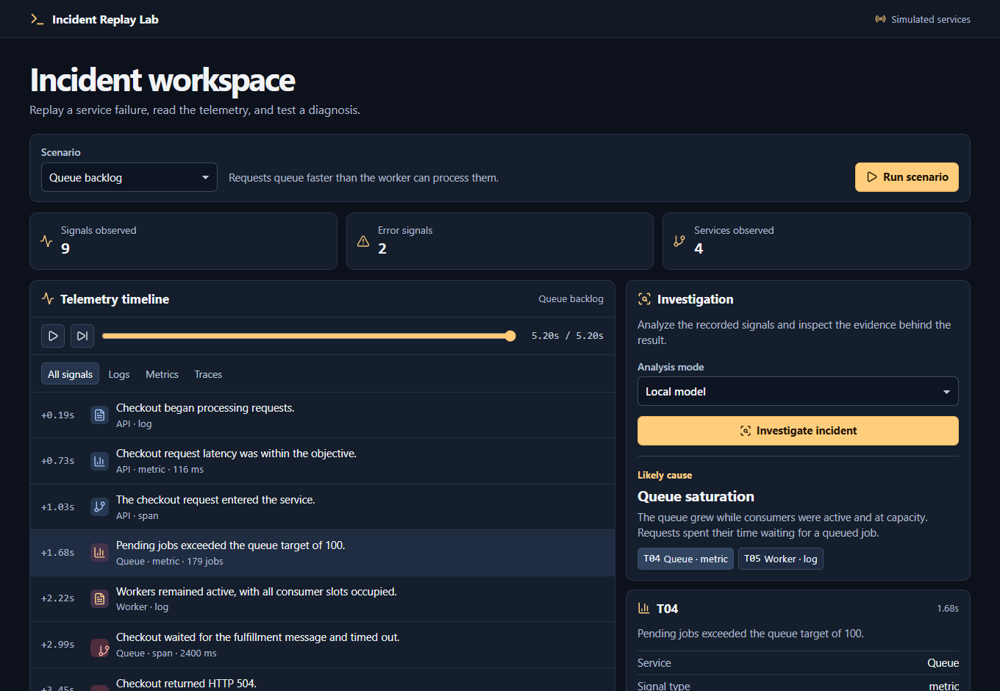

# Incident Replay Lab

A TypeScript, Node.js, PostgreSQL, and React lab for investigating simulated service failures. The playback timeline shows timestamped logs, metrics, and trace spans. A read-only analysis compares a hypothesis against the stored evidence and returns clickable citations.



## Run

```sh
docker compose up --build
```

Open [the lab](http://127.0.0.1:8792). Run **Queue backlog**, wait for the replay to finish or select **Skip to end**, then choose **Investigate incident**. Open a cited event to see its original timestamp, service, and signal. Run **Competing signals** to see a case where the lab cannot distinguish two plausible causes.

For a native run, use Node.js 22.12+ and a dedicated PostgreSQL database. Set `DATABASE_URL` to the database connection string, or set the standard PostgreSQL environment variables.

```sh
npm ci
npm run build
npm start
```

The app initializes its table and binds to localhost by default. Docker runs as a non-root account and Compose keeps PostgreSQL internal. The lab only accepts named synthetic scenarios. It has no connector for ingesting private production telemetry.

### Enable local AI

Install Qwen 2.5 1.5B in Ollama and set `OLLAMA_MODEL=qwen2.5:1.5b` before you start the app. `OLLAMA_URL` defaults to `http://127.0.0.1:11434` outside Docker. Set it to an Ollama endpoint reachable from the app if using Compose. Choose **Local model** in the Investigation panel. The evidence-rule mode works offline without the model.

## How it works

- Each run stores an immutable replay generated from a named scenario and a deterministic seed. Run URLs reopen the original signals from PostgreSQL.
- The browser animates the timeline and supports pause, replay, scrubbing, and filters for logs, metrics, and traces.
- The rules require two supporting observations for a cause. They abstain if there are missing signals or competing explanations.
- Ollama reviews the telemetry and can confirm or decline the plausible diagnosis. It returns a constrained cause and evidence IDs. The server checks those IDs and renders the original telemetry. An unavailable or invalid model response falls back to the rules with a visible notice. The model has no tools and cannot take remedial actions.

## Verify

```sh
npm run build
npm test
npm run eval
npm run eval -- --ollama
```

Set `TEST_DATABASE_URL` to a separate PostgreSQL database to include API persistence tests. The evaluation covers six scenarios with two seeds each, checking known causes, abstentions, and exact citation provenance. The Ollama run also fails if an answer silently falls back to rules. GitHub Actions runs the build, PostgreSQL tests, and deterministic evaluation.

| Mode | Cited diagnoses | Correct abstentions | Fallbacks | Fixture checks |
| --- | ---: | ---: | ---: | ---: |
| Evidence rules | 8/8 | 4/4 | 0 | 12/12 |
| Local Ollama with Qwen 2.5 1.5B | 8/8 | 4/4 | 0 | 12/12 |

These results cover the synthetic scenarios. Missing or competing evidence triggers an abstention before a model call. On the test machine, the first model confirmation took 3.8 seconds. The seven subsequent confirmations took 190–209 ms each.
